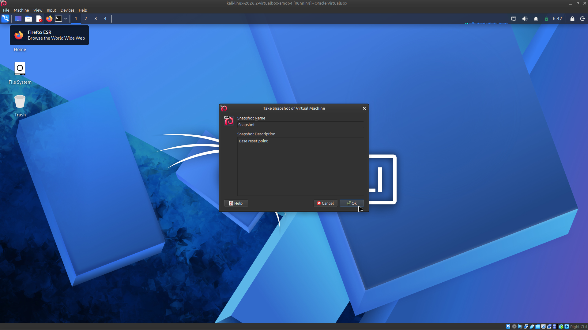

# 🔐 Cybersecurity Lab Environment Setup

**Assignment Submission — Week 1, Project Module 1 (WK1-PM1)**

Building a controlled virtual lab for cybersecurity learning, penetration testing, and ethical hacking practice.

---

## 📌 Project Overview

This project documents the setup of a beginner-friendly cybersecurity lab using **Oracle VirtualBox** and **Kali Linux** on a **Linux Mint xfce** host computer.

The purpose of this lab is to establish a controlled virtual environment for learning cybersecurity fundamentals, practicing authorized security testing, and conducting future hands-on security projects.

The setup includes a dedicated VirtualBox **NAT Network**, Kali Linux network configuration, connectivity testing, and a **clean virtual machine snapshot** for recovery.

---

## 🎯 Objectives

- Install and configure Oracle VirtualBox.
- Import and run the Kali Linux virtual machine.
- Create a private NAT Network for the cybersecurity lab.
- Inspect and configure Kali Linux network settings.
- Verify network connectivity and DNS resolution.
- Take a clean VM snapshot for recovery.
- Document the lab setup process with screenshots.
- Prepare the environment for future cybersecurity projects and practical exercises.

---

## 🛡️ Purpose of the Lab

This lab provides a practical environment for developing foundational cybersecurity skills **without** conducting security experiments on unauthorized systems.

The environment will support future learning activities, including:

- Network security fundamentals.
- Linux system administration.
- Ethical hacking and authorized penetration testing.
- Digital forensics and evidence handling.
- Security monitoring and incident investigation.
- Hands-on cybersecurity portfolio development.

> ⚠️ **Important:** This laboratory must only be used for systems that you own or have explicit permission to test. Do not use the lab or its tools to attack unauthorized systems.

---

## 🏗️ Lab Architecture

The lab uses a **Linux Mint xfce os** running **Oracle VirtualBox**, with **Kali Linux** operating as a guest virtual machine.

A dedicated VirtualBox NAT Network provides a separate virtual networking environment for future lab machines. Network isolation settings should be reviewed before introducing additional virtual machines or conducting security exercises.

| Layer | System or network | Details |
|---|---|---|
| Host | Linux Mint xfce | Physical host operating system |
| Hypervisor | Oracle VirtualBox 7.1.4 | Runs the Kali Linux guest virtual machine |
| Virtual network | NAT Network (`NatNetwork`) | Network address: `10.0.0.0/24` |
| Gateway | VirtualBox NAT Network | `10.0.0.1` |
| DNS | VirtualBox NAT Network | `8.8.8.8` |
| Guest VM | Kali Linux 2026.2 | IP address: `10.0.0.2/24` (attacker VM) |

---

## ⚙️ Lab Configuration

| Component | Configuration |
|---|---|
| 🧰 Hypervisor | VirtualBox 7.1.4 |
| 🐉 Security OS | Kali Linux 2026.2 |
| 🧠 Kali RAM | 4096 MB |
| 🌐 Virtual Network | NAT Network (`NatNetwork`) |
| 📡 Network Address | `10.0.0.0/24` |
| 🐧 Kali IP Address | `10.0.0.2/24` |
| 🚪 Default Gateway | `10.0.0.1` |
| 🌍 DNS Server | `8.8.8.8` |


---

## 🪜 Lab Setup Procedure

### Step 1: Install 7-Zip

Installed **7-Zip** on the host computer to extract compressed files, including `.7z` archives, when preparing virtual machine installation files.

- Download: [Official 7-Zip website](https://7-zip.org/download.html)

### Step 2: Install Oracle VirtualBox

Installed **Oracle VirtualBox** on the host computer. VirtualBox allows Kali Linux to run inside a virtual machine without replacing the host operating system.

- Download: [Official VirtualBox website](https://virtualbox.org/wiki/Downloads)

### Step 3: Create a Private NAT Network

Opened Oracle VirtualBox and created a dedicated NAT Network for the cybersecurity lab.

1. Opened VirtualBox's network configuration settings (`File → Tools → Network`, or `Ctrl+H`).
2. Switched to the **NAT Networks** tab and clicked **Create**.
3. Assigned the network name `NatNetwork`.
4. Set the **IPv4 Prefix** to `10.0.0.0/24`.
5. Enabled **DHCP**.
6. Attached the Kali Linux virtual machine to the intended NAT Network.
7. Verified that the selected network configuration matches the lab requirements.


> **Note:** A NAT Network provides virtual networking and outbound connectivity, but it should not automatically be considered a fully isolated security boundary. Review network connectivity and access settings before performing security experiments.

### Step 4: Import and Start Kali Linux

The Kali Linux virtual machine was downloaded from the official Kali Linux website and imported into Oracle VirtualBox.

- Download: [Kali Linux — Get Kali](https://kali.org/get-kali)

**Virtual machine network configuration:**

| Setting | Value |
|---|---|
| Adapter | Adapter 1 |
| Attached to | NAT Network |
| Network Name | `NatNetwork` |
| Adapter Type | Intel PRO/1000 MT Desktop |
| Promiscuous Mode | Allow All |
| Cable Connected | ✔️ Enabled |


**Virtual machine resource allocation:**

| Resource | Value |
|---|---|
| RAM | 4096 MB |
| Base Memory | 2048 MB (VirtualBox baseline) |
| Nested Paging | ✔️ Enabled |


### Step 5: Configure the Kali Linux Network

Inspected the Kali Linux network settings through the graphical network settings interface.

1. Opened the Kali Linux network settings.
2. Reviewed the available network interface and connection status.
3. Confirmed that the virtual machine is connected to the intended VirtualBox network.
4. Set the IP address to **`10.0.0.2/24`** with gateway **`10.0.0.1`** and DNS **`8.8.8.8`**.
5. Verified that the connection is active.


### Step 6: Configure a Shared Folder

A VirtualBox shared folder was used to transfer screenshots and documentation between the Windows host and Kali Linux.

1. Created a `Downloads` folder on the Windows host for lab file transfers.
2. Opened the Kali Linux virtual machine's settings in VirtualBox.
3. Navigated to **Shared Folders** and added the host folder with:
   - **Folder Path:** `C:\Users\<you>\Downloads`
   - **Folder Name:** `Downloads`
   - **Auto-mount:** ✔️ Enabled
   - **Access:** Full
4. Confirmed that Kali Linux can access the shared folder.

### Step 7: Take a Clean VM Snapshot

A clean snapshot of the Kali Linux virtual machine provides a recovery point before performing cybersecurity lab exercises. It can help restore the VM to its saved state if a future experiment causes unexpected configuration changes.

The clean snapshot was created using Oracle VirtualBox's snapshot functionality (`Machine → Take Snapshot`).



> **Verification:** The screenshot documents the Kali Linux virtual machine and its clean snapshot in Oracle VirtualBox. The snapshot can be used as a recovery point before future lab activities.

---

## 🌐 Kali Internet Troubleshooting

> ⚠️ **Known issue:** Internet connectivity problems are common with **VirtualBox v7** and **Kali Linux 2026.1 or newer** versions.

If your Kali VM has no internet access:

1. Verify that the NAT Network was created correctly.
2. Verify that all VM network settings are correct.
3. Ensure no other VM on the same NAT Network is using `10.0.0.2`.
4. Run the fix commands below, then restart Kali Linux.
5. Restart the virtual machines and your host OS.
6. Check the course video comments for community-reported fixes.
7. Post your issue in the video comments with your correct name so the instructor and community can help.

### Fix Commands

```bash
sudo nmcli connection modify "Wired connection 1" ipv4.dad-timeout 0
sudo nmcli connection down "Wired connection 1"
sudo nmcli connection up "Wired connection 1"
```

After running these commands, restart the Kali VM (and the host if necessary).

---

## 🔎 Lab Verification

The Kali Linux lab environment was verified by checking the network interface configuration, testing connectivity to the NAT Network gateway and an external IP address, and confirming that the clean VM snapshot can restore the baseline configuration.

| Test | Command | Expected Result |
|---|---|---|
| Check IP address | `ip a` | Correct Kali Linux IP address (`10.0.0.2/24`) displayed |
| Test gateway | `ping -c 4 10.0.0.1` | Successful replies from the gateway |
| Test Internet connectivity | `ping -c 4 8.8.8.8` | Successful replies from the external IP address |
| Test DNS resolution | `ping -c 4 kali.org` | Domain resolves and replies received |
| Verify snapshot | Restore the clean snapshot and run `ip a` | Baseline configuration restored |

### Actual Network Results

The following table records the network values configured for the Kali Linux lab environment.

| Network setting | Recorded value |
|---|---|
| IP address | `10.0.0.2/24` |
| Gateway | `10.0.0.1` |
| DNS | `8.8.8.8` |


---

## 🐞 Problems Encountered & Solutions

During lab setup and verification, the following troubleshooting approaches are useful when issues arise.

| Potential Problem | Troubleshooting Approach |
|---|---|
| Compressed file cannot be extracted | Confirm that 7-Zip is installed and the downloaded archive is complete. |
| Kali Linux does not start | Review the VM configuration and confirm that the virtual machine image was imported correctly. |
| Network connection is unavailable | Check the VirtualBox network attachment and Kali Linux network settings. |
| No internet despite network connection | Run the `nmcli` fix commands above; restart VM and host. |
| Domain connectivity test fails | Check the connection status, hostname resolution, and whether ICMP traffic is filtered. |
| Shared folder is inaccessible | Review the VirtualBox shared-folder configuration and guest permissions. |
| VM configuration becomes unstable | Use the clean snapshot as a recovery point, after considering any changes that would be lost. |

> These are troubleshooting references for the lab. They should not be interpreted as a claim that every listed problem occurred during setup.

---

## 💡 What I Learned

This project strengthened my ability to design, configure, and document a controlled
virtual environment for cybersecurity practice. Key outcomes included:

- **Virtual infrastructure:** Deployed Kali Linux in Oracle VirtualBox and allocated
  appropriate resources for repeatable lab use.
- **Network configuration:** Designed a dedicated NAT Network and configured the
  guest interface with the required addressing, gateway, and DNS settings.
- **Connectivity validation:** Applied a structured verification process to confirm
  interface configuration, gateway reachability, external connectivity, and DNS
  resolution.
- **Operational resilience:** Created a clean VM snapshot and configured shared
  resources to support safe experimentation and efficient recovery.
- **Technical communication:** Translated configuration decisions, verification
  steps, and troubleshooting procedures into clear documentation suitable for
  technical review and future lab maintenance.
- **Security practice:** Reinforced the importance of authorization, isolation, and
  controlled recovery when preparing environments for ethical security testing.

---

## 🔐 Security & Ethical Use

This lab is intended for **educational purposes** and **authorized security testing** only.

> ⚠️ Never use the lab or its tools to attack systems you do not own or have explicit permission to test.

---

## 🔗 Tools & Resources

- [Oracle VirtualBox](https://virtualbox.org/wiki/Downloads) — Virtualization platform.
- [Kali Linux](https://kali.org/get-kali) — Linux distribution for cybersecurity and penetration testing.
- [7-Zip](https://7-zip.org/download.html) — File archiving and extraction utility.
- [Kali Linux Documentation](https://www.kali.org/docs/) — Official installation and usage documentation.
- [GitHub](https://github.com) — Source control and portfolio hosting.
- [NetworkWalks](https://networkwalks.com) — Course material and video guides.

---


## ⚠️ Disclaimer

This project is provided for **educational and authorized security testing purposes only**. The author assumes no liability for misuse of the tools, techniques, or configurations described in this repository. Always obtain explicit permission before testing any system you do not own.